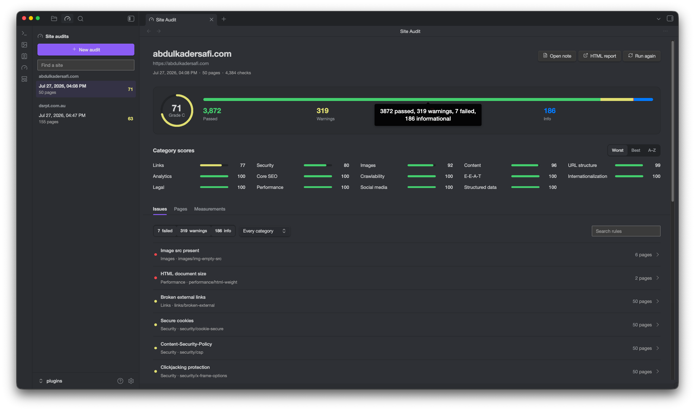

# Safi Site Audit

An Obsidian plugin that runs website audits from inside your vault. It wraps the
[Safi-Studio-Scanner](https://github.com/Abdulkader-Safi/Safi-Studio-Scanner) engine, which
crawls a site and scores it across SEO, content, links, images, structured data, security,
crawlability and more: 94 rules in 15 categories.



## What it does

- Runs an audit on any URL and reports progress live while it crawls and checks.
- Saves every run as three exports in a folder named after the site.
- Shows the report full width in a main tab: overall score, category breakdown, every
  issue with its fix, per-page findings, and the scanner's per-page measurements.
- Keeps your audit history in the sidebar, grouped by site.

## Where audits are saved

Each run writes three siblings under the audit folder you set in settings:

```
Site Audits/
  example.com/
    2026-06-28-15-30.md      readable report, opens in Obsidian
    2026-06-28-15-30.json    full report data, what the dashboard reads
    2026-06-28-15-30.html    standalone report, opens outside Obsidian
```

The note holds small frontmatter and the rendered Markdown, nothing else. Versions up to
0.5.x embedded the entire report as JSON inside the note, which on a large crawl meant
megabytes of JSON in a Markdown file and a note that took a long time to open. Audits saved
that way still open in the dashboard.

## Usage

1. Enable the plugin, then open settings and set the **Audit folder**.
2. Click the gauge ribbon icon, or run the command **Safi Site Audit: Open dashboard**.
3. Enter a URL, optionally set how many pages to crawl (empty uses the default, 20), and
   run. The report saves to your folder and opens in the dashboard.

**Open note** opens the Markdown. **HTML report** hands the HTML export to your browser.
**Run again** starts a fresh audit of the same site.

### PageSpeed Insights (optional)

To add Core Web Vitals and accessibility checks, paste a Google PageSpeed Insights API key
in settings. Local-browser auditing (Playwright) is not supported inside Obsidian; PSI is
the enrichment path.

## How it works

The scanner calls `fetch` directly with manual redirects, which Obsidian's renderer blocks
under CORS. During an audit the plugin swaps `window.fetch` for a shim backed by Obsidian's
`requestUrl()`, which bypasses CORS, then restores it. One known trade-off: redirects are
auto-followed, so the redirect-chain rule reports 0.

Progress comes from the scanner's `auditStream()`, which emits an event per page fetched
and per check completed.

## Development

```bash
npm install        # pulls safi-studio-scanner from npm
npm run build      # esbuild -> main.js
npm run dev        # watch build
npm test           # report-file self-checks
```

Styling lives in `styles.css`, hand-written and scoped under `.safi-site-audit` and
`.safi-site-audit-list`. It is built entirely on Obsidian's theme variables, with no colour
literals and no bundled fonts, so the plugin follows whatever theme you have installed. It
is not generated, so edits to it need a plugin reload, not a rebuild.
